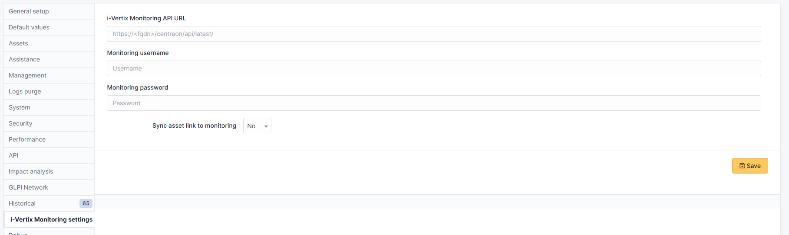
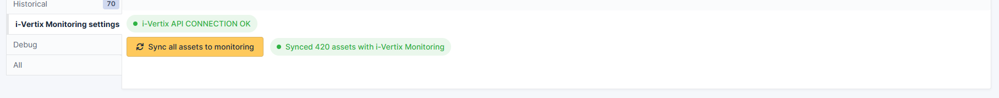
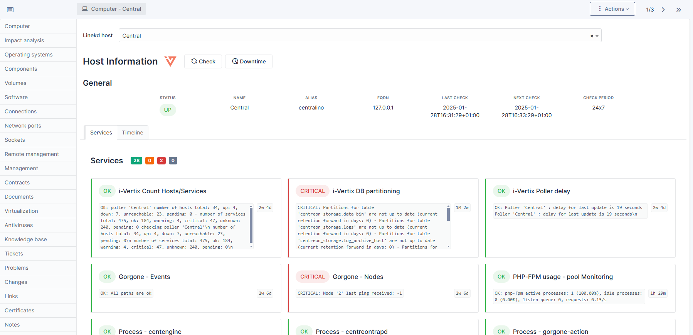
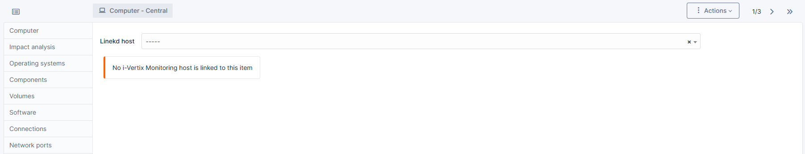
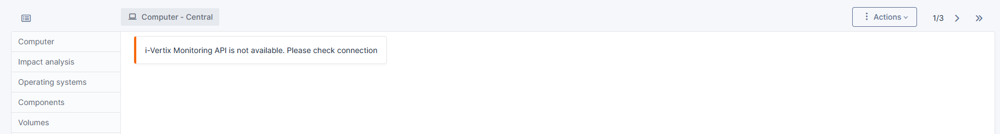
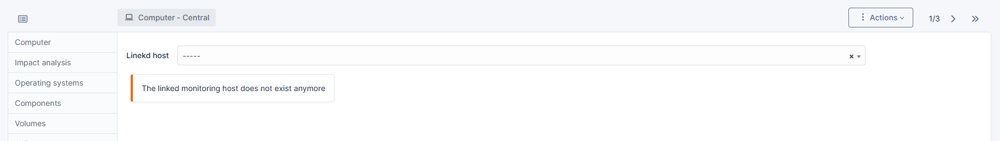
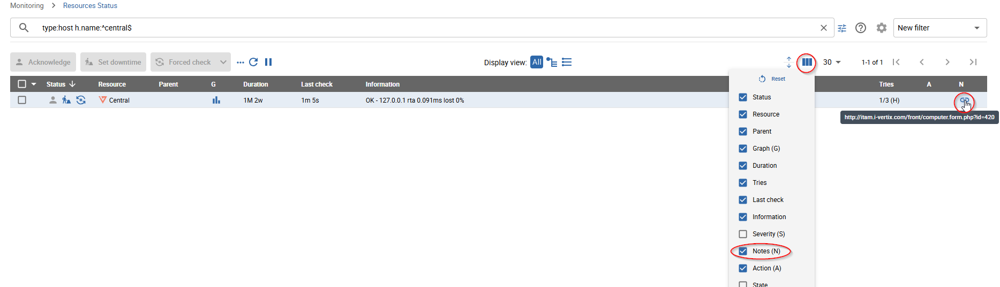

[](https://i-vertix.com)

# i-Vertix Monitoring GLPI plugin

This plugin is used to integrate realtime monitoring information from the i-Vertix Monitoring into GLPI.

The plugin supports following asset types:

- Computers
- Network devices

| Plugin version | GLPI version | PHP version |
|----------------|--------------|-------------|
| 12.0.x         | 12.0.x       | 8.3+        |
| 11.0.x         | 11.0.x       | 8.2+        |
| 10.0.x         | 10.0.x       | 7.4+        |

## 🔧 Installation

1. Download the latest version
   from [https://github.com/i-Vertix/glpi-i-vertix-monitoring/releases](https://github.com/i-Vertix/glpi-i-vertix-monitoring/releases).
2. Extract the archive into the GLPI plugins folder
3. Verify, that the folder `ivertixmonitoring` is created
4. On Linux, make sure the `ivertixmonitoring` folder and all of its subfolders have the following permissions:

    ```bash
    sudo chown apache:apache -R ./ivertixmonitoring
    sudo chmod 644 -R ./ivertixmonitoring
    sudo chmod 755 ./ivertixmonitoring
    sudo find ./ivertixmonitoring -type d -exec chmod 755 {} +
    ```

   Basically, the `ivertixmonitoring` plugin folder and all of its subfolders must have the permission level `rwxr-xr-x`
   (755) and all the files inside `rw-r--r--` (644)

5. Log into GLPI with a super-admin account and install the plugin

## ⚙️ Plugin Configuration

The i-Vertix Monitoring API is used to fetch realtime monitoring data for connected assets.

### 🔑 i-Vertix Monitoring user

You need an active i-Vertix Monitoring user for the plugin configuration.
It is recommended to create a dedicated user for your GLPI Monitoring integration.

The user must have the following permissions:

- view relevant hosts and services
- set downtimes on hosts and services
- view downtimes
- acknowledge host and service problems
- force checks on hosts and services

Additionally, the user **must** have the following settings enabled:

- Reach API Realtime
- Reach API Configuration

### Configure the connection to the Monitoring system

To configure the API connection, log into GLPI with a super-admin account and open the `Setup -> General` page.
On the new tab `i-Vertix Monitoring settings`, you must configure following information:

- **i-Vertix Monitoring API Url**: the FQDN to your i-Vertix Monitoring API; the domain must be reachable from the *
  *GLPI instance**!
- **Authentication**: either
  - **Monitoring username** and **Monitoring password** of the i-Vertix Monitoring user (leave the password empty to
    keep the saved one), or
  - an **API token**, see [Authentication with an API token](#authentication-with-an-api-token)
- **Verify TLS certificate**: verify the TLS certificate of the monitoring server (default: *Yes*).
  Disable it only if your monitoring server uses a self-signed certificate.
- **Sync asset link to monitoring**: choose, if a link to the GLPI asset should be automatically configured on the
  monitored host

Click `Save` to save the provided information.

### Authentication with an API token

Since version 24.10, the i-Vertix Monitoring supports API tokens. Instead of username and password, you can enter a
token in the field **API token**:

1. In the i-Vertix Monitoring, create a token for the integration user (`Administration -> Authentication tokens`).
   The user needs the [permissions](#-i-vertix-monitoring-user) listed above.
2. Paste the token in the field **API token** and click `Save`.

Only one authentication is stored: saving a token deletes username and password, saving username and password deletes
the token. Entering both at the same time is refused.
The token and the password are stored encrypted with the GLPI key and are never shown again: leave the field empty to
keep the saved value. The fields are not password fields, so browsers do not suggest or save passwords for them.
Tokens expire: when the connection fails with *the API token is invalid or expired*, create a new token.

### Monitoring server in a private network (GLPI 12)

Since GLPI 12, GLPI blocks server-side requests to private networks (e.g. `10.0.0.0/8`, `172.16.0.0/12`,
`192.168.0.0/16`) by default. As the i-Vertix Monitoring usually runs in your internal network, you have to allow the
plugin to reach it. Add the following lines to the file `config/local_define.php` of your GLPI installation (create the
file if it does not exist):

```php
<?php
define('GLPI_SERVERSIDE_URL_ALLOWED_PRIVATE_NETWORKS_CONTEXTS', [
    \Agent::class,
    \Auth::class,
    \GlpiPlugin\Ivertixmonitoring\Config::class,
]);
```

If you already define this constant, just add `\GlpiPlugin\Ivertixmonitoring\Config::class` to the list.
The settings page shows this hint when the connection fails because of this restriction.

The requests to the monitoring API use the proxy configured in `Setup -> General -> System`. To bypass the proxy for the
monitoring API, add *i-Vertix Monitoring* to the proxy exclusions on the same page.



### Verify the API connection

After you have saved the Monitoring API configuration, you can verify the API connection at the bottom of the
configuration page.



#### 🔴 Connection to the i-Vertix Monitoring API failed

This error indicates that the GLPI system was unable to successfully connect to the Monitoring API, using the provided
url and credentials. The reason is shown below the status. What you can do:

- Allow requests to the [private network](#monitoring-server-in-a-private-network-glpi-12)
- Verify that the GLPI system can reach the Monitoring system (e.g. by ping the monitoring instance or by nslookup)
- On a TLS certificate error, install the CA of the monitoring server on the GLPI server or disable
  *Verify TLS certificate*
- Verify the provided user credentials (e.g. try to log into the monitoring system directly with the provided
  credentials)
- Verify the [required user permissions](#-i-vertix-monitoring-user)

#### 🟢 Connected to the i-Vertix Monitoring API

Connection OK indicates, that the connection to the i-Vertix Monitoring API was successfully established.
You are now ready to use the i-Vertix Monitoring GLPI integration.

To automatically link your assets with monitored hosts on the i-Vertix Monitoring, click
the `Sync all assets to monitoring` or `Automatically link assets to monitoring hosts (by name)` button, depending on
your *Sync asset link to monitoring* setting.
Both actions try to match the names of assets and monitored hosts and creates a link on matching names (exact match).
In addition, *Sync all assets to monitoring* adds the asset weblink on the matched host.
Assets that are already linked, deleted assets and templates are skipped.

## 🔐 Rights

The plugin adds the right *i-Vertix Monitoring* to the profiles (`Administration -> Profiles -> i-Vertix Monitoring`):

| Right          | Allows                                                                       |
|----------------|------------------------------------------------------------------------------|
| Read           | view the `i-Vertix Monitoring` tab and the *Host Status* search column       |
| Link hosts     | link and unlink assets and monitoring hosts, *Sync all assets to monitoring* |
| Run actions    | send checks, set and cancel downtimes, acknowledge problems                  |

The rights are always combined with the rights on the asset (entity included): *Read* and *Run actions* need read
access to the asset, *Link hosts* needs update access. A monitoring host that is already linked to an asset can only be
linked to another asset by users who can update that asset too. *Sync all assets to monitoring* additionally needs the
right to update the GLPI configuration.

All actions are executed in the i-Vertix Monitoring with the user configured in the plugin settings.

On installation (and on the update from 11.0.x), profiles that can update computers or network devices get all rights,
profiles that can only read them get *Read*.

## 👀 View host information on assets

To view the host information on assets (currently only *Computers* and *Network devices* supported),
open the asset form and navigate to the `i-Vertix Monitoring` tab.

On this tab, you can view the basic host information, the current host status, configured downtimes, service problems
and an event-timeline.
You can also issue a re-check of the connected host, acknowledge problems and schedule downtimes.



### 🗿 Troubleshooting

Following problems may occur on the i-Vertix Monitoring page:

#### No i-Vertix Monitoring host linked to item



This error indicates, that currently no host is linked to the current item. To link a host to the item, select a
monitored host from the above combo box.

#### i-Vertix Monitoring API is not available



This error indicates, that the API connection to the i-Vertix Monitoring system can not be established.
Please check the provided credentials in the [plugin configuration](#configure-the-connection-to-the-monitoring-system)
or the [permissions](#-i-vertix-monitoring-user) of the provided i-Vertix Monitoring user.

#### The linked monitoring host does not exist anymore



This error indicates, that the linked monitored host was deleted or disabled on the i-Vertix Monitoring system.
You can remove the existing link by clicking the `x` in the above combo box or link a new host to the host by selecting
one from the combo box.

## Asset link in the i-Vertix Monitoring



All monitoring hosts, which are linked to an asset have a weblink of the connected asset as a note.
The weblink is only created when *Sync asset link to monitoring* is enabled in
the [plugin configuration](#configure-the-connection-to-the-monitoring-system).

The weblink is available on the *Resource Status* page of your connected i-Vertix Monitoring solution.
Remember to enable the list-column *Notes* in the list configuration (see image above).

## Translation

The plugin is translated to English (`en_GB`), German (`de_DE`) and Italian (`it_IT`).

### Rules for strings

- Every string uses the plugin domain: `__('Text', 'ivertixmonitoring')` in PHP and Twig, also for strings that exist
  in GLPI itself. Strings without domain are not extracted.
- Use placeholders instead of concatenation, so translators can change the word order:
  `sprintf(__('From: %s', 'ivertixmonitoring'), $date)` in PHP,
  `{{ __('From: %s', 'ivertixmonitoring')|format(date) }}` in Twig.
  Use numbered placeholders (`%1$s`, `%2$s`) when there are several.
- Use `_n()` for strings with a number: `_n('%d asset linked', '%d assets linked', $count, 'ivertixmonitoring')`.
- Escape translations used inside JavaScript strings: `"{{ __('Text', 'ivertixmonitoring')|e('js') }}"`.
- Host and service states returned by the API (`UP`, `DOWN`, `OK`, ...) are translated by `Host::getStatusLabels()`.

### Update the translation files

1. Extract the strings from the `.php` and `.html.twig` files with GLPI's `extract-locales` script (part of the
   `glpi-project/tools` dev dependency, installed by `composer install`):

    ```bash
    ./vendor/bin/extract-locales
    ```

   It writes `locales/ivertixmonitoring.pot` and regenerates `locales/en_GB.po`.
   It needs PHP, `xgettext` and `msginit` in the `PATH`. On Windows, run it in *Git Bash* with the
   [gettext binaries](https://mlocati.github.io/articles/gettext-iconv-windows.html) in the `PATH`
   (e.g. `export PATH="/c/Dev/utils/gettext/bin:$PATH"`).

2. Open `locales/de_DE.po` and `locales/it_IT.po` in Poedit, update them from the `.pot` file
   (*Translation -> Update from POT File*), translate the new strings and save. Poedit compiles the `.mo` file on save.

3. Commit the `.pot`, `.po` and `.mo` files (GLPI loads the `.mo` files at runtime).
